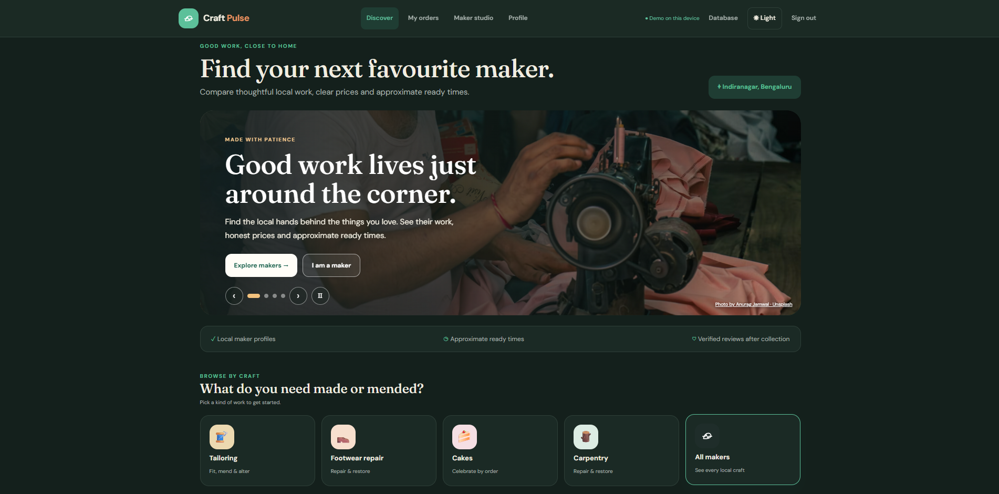

# 🛠️ Craft Pulse

> **Local makers, close to home.** Discover, order and track from the maker next door.

A neighbourhood-maker marketplace where customers find nearby tailors, cobblers, cake bakers and carpenters, then order from them. Makers manage requests, quotes and queues from their own inbox.

**Team:** igniora (Dheep Sharan, Sankara Magesh, Dheeranjai)
**Event:** GDG on Campus, Hack Build'26 · **Track:** Open Innovation

---

## 📷 Project Preview

---

## 🌐 Live Demo

https://dheepsharan.github.io/HackBuild-26/

---

✨ Features
-------------
Discover nearby makers by craft, rate and distance
Fixed-price orders or custom quotes that the customer confirms
Live order tracking with queue and ready-time estimates
Maker inbox with the full order lifecycle (requested, accepted, started, ready, collected)
Saved makers, reviews and ratings
Printable invoice (simulated UPI / card / pay at pickup in the demo)
Runs in demo mode in the browser; a Firebase backend is included for real sign-in (not connected yet)

🧰 Tech Stack
--------------
HTML · CSS · JavaScript · Firebase Authentication · Cloud Firestore · Cloud Functions (Node.js 22)

🚀 Run Locally
--------------------
No installation needed. Download or clone the repo and open index.html in a browser, then choose Customer demo to place an order, or a maker button such as Sole Stories · Footwear repair to open that shop's inbox.
Demo data (accounts, listings and orders) is stored only in your own browser and is not shared with other visitors. Demo UPI and card payments do not charge any money.

⚙️ Backend (Included, Not Connected Yet)
---------------------
The Firebase backend code is part of this repo, but no Firebase project is connected yet, so the live site runs in demo mode. It is designed to support:

Email/password sign-in and account creation
Maker discovery, categories, rates, hours, location and worker count
Saved makers
Order requests, quotes, secure status changes and queue estimates
Reviews after an order is collected
Google Maps search links and device-based distance estimates

🔧 Still In Progress
------------------------
This prototype does not include a KYC/identity-check service or Firebase Storage photo-upload code. The KYC screen therefore tells you it is not connected, and shop-logo/work-photo previews are not uploaded. The provider data model also has no shop introduction or individual product-photo fields; it stores services and their rates/times. Do not enter identity documents into this prototype. Google Maps links open Maps using maker coordinates; this prototype does not embed the Google Maps API map.

When Firebase settings are blank, the app remains in demo mode. When settings are filled, use a real Firebase account; the demo-account buttons are hidden.

📁 Repository Contents
--------------------------
index.html — the Craft Pulse UI and demo data

backend/connect-ui.js — connects supported UI actions to the backend

backend/ — Firebase web API, validation and data mapping

functions/ — trusted Cloud Functions for writes and order transitions

firestore.rules and firestore.indexes.json — database security and query setup

firebase.json — Firebase CLI deployment configuration

firebase-config.js — your Firebase web-app settings

BACKEND_INTEGRATION.md — backend architecture and API reference
